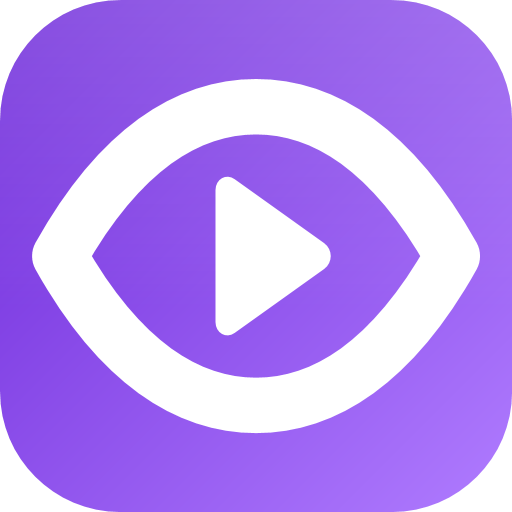
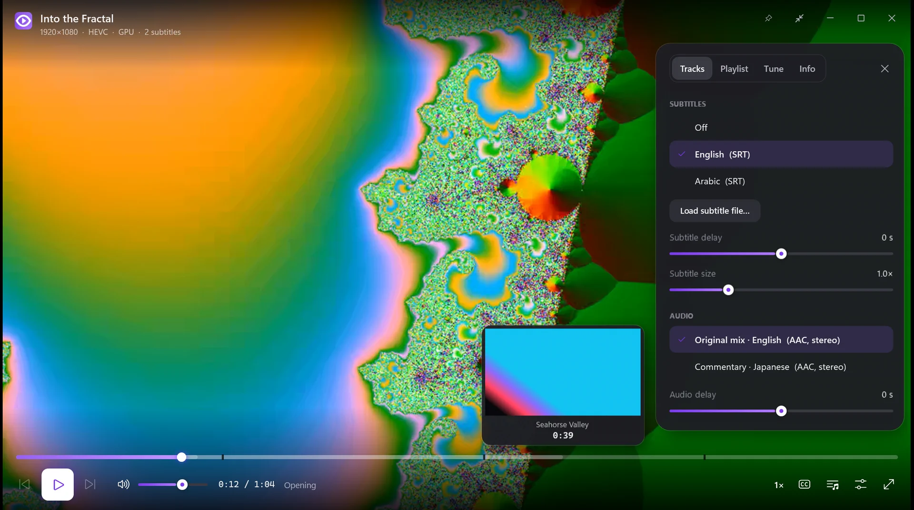
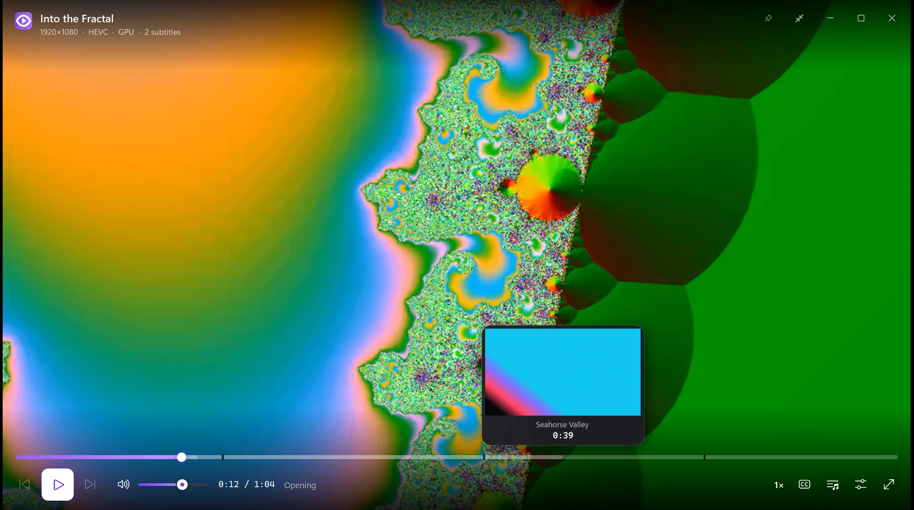
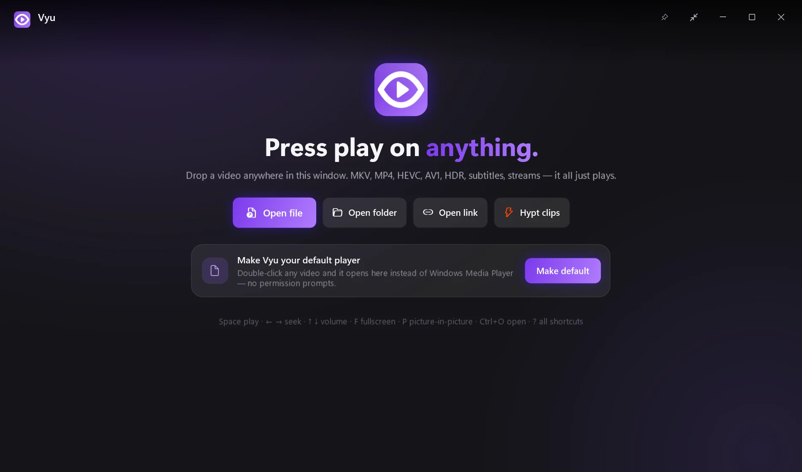

<p align="center">
  
</p>

<h1 align="center">Vyu</h1>
<p align="center"><b>Press play on anything.</b> A fast, beautiful video player for Windows — mpv's engine, a calm interface, zero clutter.</p>

<p align="center">
  <a href="https://github.com/MSEVENDEV/vyu/releases/latest"><b>Download for Windows</b></a> ·
  <a href="https://msevendev.github.io/vyu/">Website</a> ·
  <a href="https://msevendev.github.io/vyu/design.html">Kinetic design system</a> ·
  <a href="https://github.com/MSEVENDEV/hypt">Hypt clipper</a>
</p>



## Why Vyu

VLC plays everything but looks like 2006. mpv plays everything *beautifully* but has no interface.
**Vyu is mpv with an interface you'd actually want to look at** — and nothing else in the way.

- **Plays everything.** MKV, MP4, WebM, MOV, AVI, TS, HEVC, AV1, VP9, 10-bit, HDR (tone-mapped), DVD/Blu-ray
  rips, PGS/ASS/SRT subtitles, audio files, HLS/DASH streams — and YouTube & friends when `yt-dlp` is installed.
- **Light and sharp.** GPU decoding (D3D11VA) and mpv's `gpu-next` renderer. The controls are a separate
  layer that stops drawing completely when it fades away, so watching costs what mpv costs.
- **Seek-bar previews.** Hover the timeline to see the frame (a second silent decoder renders tiny keyframes).
- **Picks up where you left off**, for every file, and plays the next episode in the folder automatically.
- **Chapters** on the timeline, **subtitle & audio track** menus with real language names, subtitle delay
  and size, audio delay, **A-B loop**, frame stepping, speed 0.25×–8× with pitch correction.
- **Picture tuning**: brightness, contrast, saturation, gamma, aspect, rotate, zoom-to-fill.
  Three quality modes: *Battery*, *Balanced*, *Cinema* (EWA-Lanczos scaling + debanding).
- **Night mode** evens out loud explosions and quiet dialogue.
- **Picture-in-picture** and **keep on top**, drag-and-drop anywhere,
  paste a file or link with `Ctrl+V`, YouTube-style `J K L` keys, mouse-wheel volume up to 150 %.
- **One window.** Opening another file while Vyu is open sends it to the same window.
- **Your default player in one click.** *Make default* on the home screen opens Vyu's page in Windows'
  Default apps and confirms when it's done. Your files keep Windows-style icons (“MP4 Video”) and thumbnails.
  No permission prompts — Vyu never asks for administrator.
- **Works like Windows' own player.** Media keys and the Windows media flyout (with a seek bar) control Vyu
  even when another window is in front; previous / play / next sit under the taskbar thumbnail; right-click
  Vyu on the taskbar for what you were watching.
- **Updates.** A pop-up offers **Later**, **Schedule** or **Update now & restart** — never over a video you're watching.
- **Your Hypt clips one click away** — Vyu is the sibling of [Hypt](https://github.com/MSEVENDEV/hypt), the voice-controlled clipper.
- Power users: drop an `mpv.conf` into `%APPDATA%\Vyu\mpv`.

<p align="center">
  
  
</p>

## Keyboard

| Keys | Action | Keys | Action |
|---|---|---|---|
| `Space` / `K` | play · pause | `F` / `Enter` / double-click | full screen |
| `←` `→` | seek 5 s (`Shift` 1 s, `Ctrl` 60 s) | `J` / `L` | back / forward 10 s |
| `↑` `↓` / wheel | volume | `M` | mute |
| `[` `]` / `Backspace` | slower / faster / normal | `,` `.` | frame back / forward |
| `V` / `A` | cycle subtitles / audio | `B` | A-B loop |
| `N` / `Shift+N` | next / previous file | `Q` | playlist |
| `P` | picture-in-picture | `T` | keep on top |
| `S` | screenshot (Pictures\Vyu) | `I` | media info |
| `0`–`9` | jump to 0–90 % | `?` | all shortcuts |
| `Ctrl+O` / `Ctrl+U` / `Ctrl+V` | open file / link / paste | `Esc` | leave full screen |

## Install

Download `Vyu-x.y.z-win-x64.zip` from [Releases](https://github.com/MSEVENDEV/vyu/releases/latest), unzip, run `Vyu.exe`.
To make it your default player: *Tune → Make Vyu my video player…*, then pick Vyu in Windows' Default apps.

## Build

```powershell
./scripts/fetch-libmpv.ps1            # libmpv-2.dll → deps/mpv
dotnet build src/Vyu/Vyu.csproj
./scripts/build-release.ps1 -Version 1.0.0
```

How it's put together: mpv renders straight into a child HWND with its own D3D11 swap chain
(`Views/VideoHost.cs`). WPF can't draw over a native swap chain, so the controls are a transparent window
owned by the video window and glued to it (`Views/ControlsWindow.xaml`). `Mpv/MpvPlayer.cs` is a small
libmpv binding; `Mpv/MpvThumbnailer.cs` uses mpv's software render API for seek previews.

## بالعربي

**فيو (Vyu)** مشغّل فيديو مجاني ومفتوح المصدر لويندوز، مبني على محرّك mpv المشهور. يشغّل كل الصيغ
(MKV و MP4 و HEVC و AV1 و HDR والترجمات العربية) بخفّة على كرت الشاشة، مع واجهة نظيفة وحركات ناعمة:
معاينة المشهد فوق شريط التقديم، يكمل من حيث وقفت، يشغّل الحلقة اللي بعدها تلقائياً، صورة داخل صورة،
ووضع ليلي للصوت. الشقيق: [Hypt](https://github.com/MSEVENDEV/hypt) لتسجيل لقطات الألعاب.

## License

GPL-3.0 (Vyu links to libmpv). See [LICENSE](LICENSE) and [THIRD-PARTY-NOTICES.md](THIRD-PARTY-NOTICES.md).
Designed with the [Kinetic design system](DESIGN.md).
